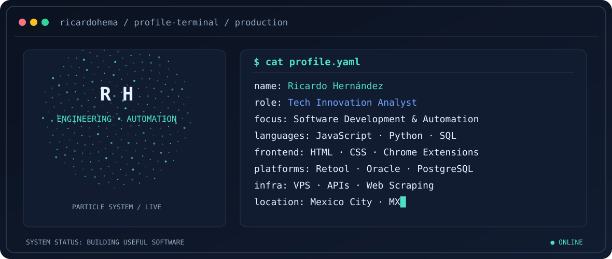

<div align="center">

<picture>
  <source media="(prefers-color-scheme: dark)" srcset="assets/banner-dark.svg">
  <source media="(prefers-color-scheme: light)" srcset="assets/banner-light.svg">
  
</picture>

<a href="https://github.com/ricardohema">
  
</a>


</div>

---

## `$ whoami`

```yaml
name: Ricardo Hernández
location: Mexico City, Mexico
current_role: Tech Innovation Analyst
professional_focus:
  - Software development and internal platforms
  - Process automation and systems integration
  - Data engineering and business intelligence
  - Browser extensions and web automation
working_with:
  - JavaScript, Python, HTML, CSS, SQL
  - Retool apps, workflows and integrations
  - PostgreSQL, Oracle and relational databases
  - REST APIs, VPS, Playwright and web scraping
```

I build practical software that connects systems, automates repetitive work and turns fragmented data into useful products. My work spans frontend development, backend integrations, internal tooling, analytics and infrastructure.

## `$ cat tech-stack.yaml`

<table>
<tr><th align="left" width="50%">Development &amp; frontend</th><th align="left" width="50%">Backend &amp; data</th></tr>
<tr>
<td><br/><code>JavaScript · HTML5 · CSS3 · Python</code></td>
<td><br/><code>SQL · PostgreSQL · Oracle · FastAPI</code></td>
</tr>
<tr><th align="left">Automation &amp; integrations</th><th align="left">Infrastructure &amp; tooling</th></tr>
<tr>
<td><br/><code>Retool · Chrome Extensions · Playwright · REST APIs · VBA · Power Automate</code></td>
<td><br/><code>VPS · Docker · Cloud Run · Cloudflare · Python services</code></td>
</tr>
<tr><th align="left">Analytics &amp; intelligence</th><th align="left">Business applications</th></tr>
<tr>
<td><code>Pandas · NumPy · Power BI · Power Query · DAX · Excel</code></td>
<td><code>Retool Apps &amp; Workflows · Salesforce integrations · dashboards · operational consoles</code></td>
</tr>
</table>

## `$ python engineering_radar.py`

<div align="center">
<picture>
  <source media="(prefers-color-scheme: dark)" srcset="assets/radar-dark.svg">
  <source media="(prefers-color-scheme: light)" srcset="assets/radar-light.svg">
  
</picture>
<br/><sub>Illustrative self-assessment for visual presentation, not independently validated proficiency scores.</sub>
</div>

---

## `$ ls selected-work/`

> The following are high-level descriptions of professional and personal development initiatives. Corporate code, internal data, credentials and proprietary architecture are not published here.

### 🔎 Sherlock · Enterprise Research & Intelligence
Company-search and research workflows combining identity information, contacts and data from multiple sources to support business investigations.

**Focus:** Application design · Data integration · Investigative workflows · Information reuse

### ⚙️ SMS Hub · Unified Operations Workspace
An internal operations interface designed to centralize tasks, documents and business process tracking across enterprise systems.

**Focus:** Retool · JavaScript · APIs · SQL · Operations automation

### 📊 SMS 360 · Operations & Commercial Analytics
A dashboard concept for understanding operational pipelines, bottlenecks and business performance.

**Focus:** Dashboard engineering · Data visualization · Business intelligence · Integrations

### 🧩 Atlas Publicador · Chrome Extension
A browser-extension project supporting property publication workflows, synchronization and operational productivity.

**Focus:** Chrome extension development · JavaScript · HTML/CSS · Browser APIs

### 🕸️ Automation & Web Data Collection
Custom scripting and browser automation involving Python, Playwright, VPS-hosted processes and structured data extraction.

**Focus:** Python · Web scraping · Scheduling · Reliability · Data processing

---

## `$ connect --links`

<div align="center">

<a href="https://github.com/ricardohema"></a>
<a href="https://github.com/ricardohema?tab=repositories"></a>

<br/><br/>
<sub>Made in Mexico City · Automate thoughtfully. Build deliberately.</sub>

</div>
