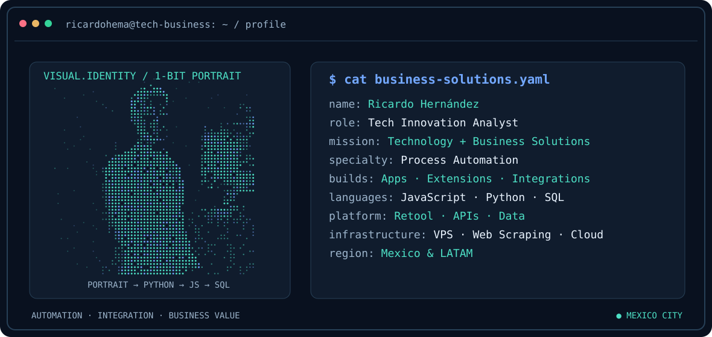

<div align="center">

<picture>
  <source media="(prefers-color-scheme: dark)" srcset="assets/portrait-banner-dark.svg">
  <source media="(prefers-color-scheme: light)" srcset="assets/portrait-banner-light.svg">
  
</picture>

<a href="https://github.com/ricardohema">
  
</a>

<br />

<a href="https://www.linkedin.com/in/ricardohema/"></a>
<a href="https://github.com/ricardohema?tab=repositories"></a>

<br />

</div>

---

## `$ whoami`

<table><tr><td width="72%" valign="top">

**Ricardo Hernández**  
**Tech Innovation Analyst · Software Developer & Automation Engineer**  
**Mexico City, Mexico · Building for Mexico & LATAM**

I turn business challenges into useful technology: process automation, internal applications, data integrations, browser extensions and operational intelligence.

<a href="https://www.linkedin.com/in/ricardohema/"></a>

</td><td width="28%" align="center" valign="middle">

</td></tr></table>

```yaml
name: Ricardo Hernández
location: Mexico City, Mexico
role: Tech Innovation Analyst
specialization: Software Development & Business Automation
mission: Turn business challenges into practical technology solutions
focus:
  - Process automation and operational efficiency
  - Business-focused web applications and internal tools
  - Systems integration and data centralization
  - Business intelligence and analytics
  - Browser extensions and web data workflows
region: Mexico & LATAM
```

I build **technology solutions for business operations**, combining software engineering, process understanding and data. My work spans internal platforms, automated workflows, system integrations, browser extensions and analytics tools — helping teams move from manual processes and fragmented information to practical, maintainable digital solutions.

## `$ cat tech-stack.yaml`

| Domain | Technologies |
| --- | --- |
| **Software development** | JavaScript · Python · HTML5 · CSS3 · SQL |
| **Automation & internal tools** | Retool Apps & Workflows · Playwright · VBA · Power Automate · UiPath |
| **Data & analytics** | PostgreSQL · Oracle · Pandas · NumPy · Power BI · Power Query · DAX |
| **Integrations** | REST APIs · Salesforce integrations · Business workflows |
| **Browser engineering** | Google Chrome Extensions · JavaScript · Browser automation · Web scraping |
| **Infrastructure** | VPS · Docker · Cloud Run · Cloudflare · FastAPI |

<div align="center">

</div>

---

## `$ python engineering_radar.py`

<div align="center">
<picture>
  <source media="(prefers-color-scheme: dark)" srcset="assets/skills-radar-v2-dark.svg">
  <source media="(prefers-color-scheme: light)" srcset="assets/skills-radar-v2-light.svg">
  
</picture>

<sub>Illustrative self-assessment of technical focus; values are not independently validated.</sub>
</div>

---

## `$ ls selected-work/`

> Professional project descriptions below are intentionally high-level. Proprietary source code, internal credentials and sensitive company information are not shared.

### 🔎 Sherlock · Enterprise Research & Intelligence
An internal tool for finding, centralizing and enriching company information across multiple sources to support investigation and research workflows.

**Focus:** Search · Data integration · Workflow efficiency · Knowledge reuse

### ⚙️ SMS Hub · Unified Operations Workspace
A centralized interface for managing tasks, documents and operational follow-up across multiple business systems.

**Focus:** Retool · JavaScript · Integrations · Process automation

### 📊 SMS 360 · Business Performance Dashboard
A business intelligence dashboard designed to increase visibility into operational and commercial performance, KPIs and bottlenecks.

**Focus:** Analytics · Reporting · Data visualization · Decision support

### 🧩 Atlas Publicador · Chrome Extension
A browser extension for streamlining property-publication workflows, synchronization and repetitive browser operations.

**Focus:** Chrome Extensions · JavaScript · HTML/CSS · Browser APIs

### 🕸️ Automation & Web Data Solutions
Custom Python automation and browser workflows for extracting, processing and structuring web-based information, including VPS-hosted utilities.

**Focus:** Python · Playwright · Web scraping · Data processing

---

## `$ echo business_impact`

- Turn complex business workflows into straightforward internal applications.
- Connect disconnected systems and data sources to improve operational visibility.
- Automate repetitive activities and reduce manual effort.
- Bridge business requirements and software implementation across Mexico and LATAM.

---

## `$ connect --links`

<div align="center">
<a href="https://www.linkedin.com/in/ricardohema/"></a>
<a href="https://github.com/ricardohema"></a>

<br /><br />
<sub>Automating processes, connecting systems and building practical solutions for real business operations.</sub>
</div>
